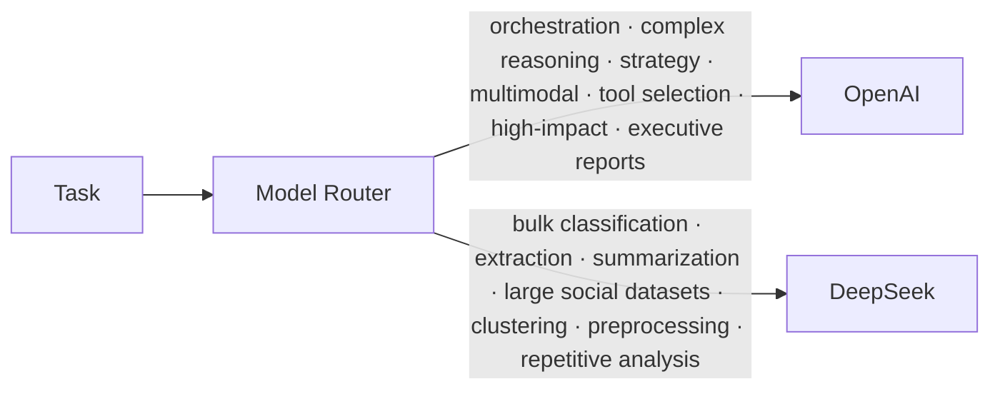
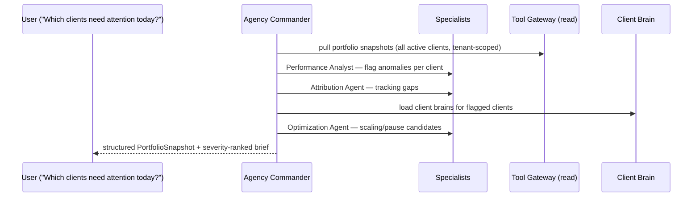

# TFast Ads Manager — Agent Architecture

## Agent Roster

| Agent | Type | Responsibility |
|---|---|---|
| **TFast Agency Commander** | LLM (OpenAI, orchestration) | Portfolio supervision; delegates to specialists; answers agency-level questions; produces Morning Brief |
| Market Intelligence Agent | LLM (DeepSeek-heavy) | Competitors, trends, customer conversations, opportunities (API Direct) |
| Advertising Strategist | LLM (OpenAI) | Campaign/audience/funnel/offer/positioning strategy |
| Creative Intelligence Agent | LLM (OpenAI multimodal) | Winning/losing creative analysis, attribute extraction |
| Creative Strategist | LLM (OpenAI) | Hooks, concepts, scripts, CTAs, offers, variations |
| Performance Analyst | LLM (DeepSeek for bulk, OpenAI for synthesis) | Performance analysis, Pareto, baselines, diagnosis |
| Optimization Agent | LLM (OpenAI for decisions) | Scaling/pausing/restructuring opportunities |
| Attribution Agent | LLM (OpenAI) | Ad activity ↔ leads/sales/bookings/revenue |
| Experiment Agent | LLM (OpenAI) | Design + evaluate experiments |
| **Budget Governor** | **Deterministic code** | Financial rules — no LLM in the loop |
| **Approval Agent** | **Deterministic code + policy** | Advisory / Approval / Autopilot modes |

**Boundary rule:** LLMs produce *recommendations*. Only deterministic modules decide *execution*.

---

## Model Routing



`server/src/providers/router.ts` implements a `TaskKind → provider` table. Business logic never hard-codes a provider; every agent call goes through `complete({ task, model: 'auto' | 'openai' | 'deepseek' })`.

| TaskKind | Provider | Example |
|---|---|---|
| orchestration | openai | Commander delegation |
| strategy | openai | campaign strategy brief |
| multimodal_creative | openai | creative attribute extraction from video |
| tool_selection | openai | choosing gateway operations |
| executive_report | openai | client weekly report |
| classification | deepseek | classify 5,000 research items |
| extraction | deepseek | pull hooks/offers from scraped ads |
| summarization | deepseek | summarize competitor feeds |
| clustering | deepseek | group research embeddings |
| preprocessing | deepseek | normalize messy API payloads |
| analysis_bulk | deepseek | sweep snapshots for anomalies |
| analysis_synthesis | openai | anomaly root-cause narrative |

---

## Structured Output Contracts

Agents communicate through typed schemas (zod), not free-form text.

```ts
// PortfolioSnapshot — Commander → dashboard/chat
{ agency_id, as_of, totals: { spend, revenue, roas, leads, qualified_leads, cpa, cpl },
  clients: [{ client_id, status: 'healthy'|'watch'|'critical', flags: [...] }] }

// OptimizationRecommendation — Optimization Agent → Approval Engine
{ action_type, entity: { type, external_id, platform }, reason,
  current_state, proposed_state, expected_impact: { metric, delta_pct },
  confidence, risk_note }

// CreativeInsight — Creative Intelligence Agent → creative_attributes
{ creative_id, format, hook, hook_type, presenter_type, opening_style,
  duration_seconds, problem, emotions: [], offer, cta, caption_style }

// ExperimentProposal — Experiment Agent
{ observation, diagnosis, hypothesis, variants: [], success_criteria, duration }

// MorningBrief — Commander (scheduled)
{ date, sections: { critical: [], needs_attention: [], scaling: [],
  creative_needed: [], tracking_problems: [], ai_recommendations: [],
  pending_approvals: [] }, severity_ranked: true }
```

---

## Commander Orchestration



The Commander **never calls write tools directly** — it emits `OptimizationRecommendation`s that enter the safety pipeline.

---

## Client Brain Loading

Before any recommendation or decision for a client, the brain service loads:
`business, brand, customers, economics, advertising_history, competitors, ai_knowledge`

Loaded as compact structured context (not raw JSON dumps) into the agent prompt. Brain updates are versioned and audited (`updated_by`, `version`).

## Memory Model

```
memories (client-scoped, confidential)
agency_knowledge (anonymized, cross-client patterns)
```

- Every lesson from a completed experiment → `memories` (kind=lesson).
- Promotion to `agency_knowledge` requires anonymization: no client names, creatives, financials, audiences, customers.
- Retrieval: pgvector cosine similarity over `embedding`, filtered by scope + tenant.

---

## Experiment Engine

```
Observation → Diagnosis → Hypothesis → Experiment → Result → Lesson → Memory
```

Each hop is a row in the DB and the chain is fully traversable (FKs). Experiments only run where automation policy permits; budgets for experiments are subject to the Budget Governor.
