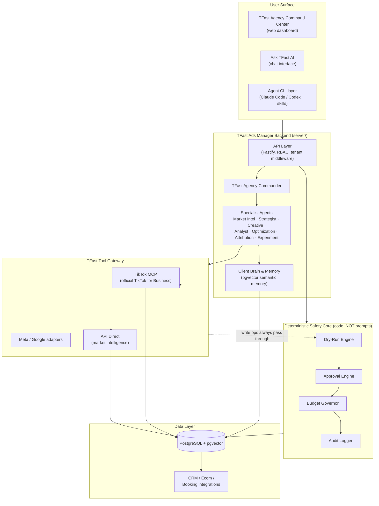
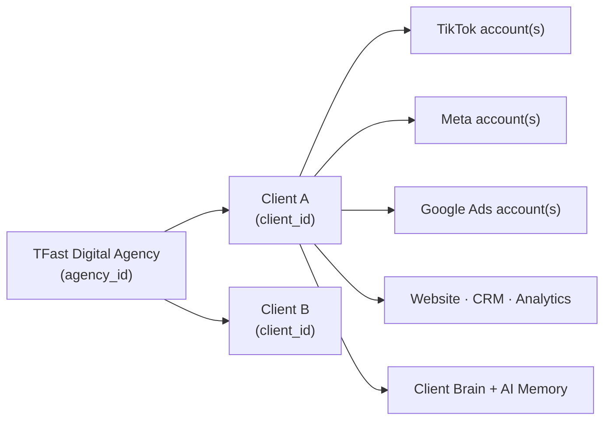

# TFast Ads Manager — Architecture

> TFast Ads Manager is an AI-powered advertising command center for agencies. It researches markets, understands client businesses, monitors advertising accounts, creates strategies and creatives, recommends optimizations, executes approved advertising actions, and continuously learns from campaign and business results.

---

## 1. System Overview



**Golden rule:** every write-capable advertising operation flows through
`Dry-Run → Approval → Budget Governor → Audit` **before** execution. Financial safety is application code, never a prompt.

---

## 2. Multi-Tenant Agency Model



Every entity row carries its tenant scope. The scope tuple flows through every layer:

```
agency_id → client_id → ad_account_id → platform → actor (user/agent)
```

**Isolation invariants:**
1. Queries are always filtered by `client_id` (derived from `agency_id` membership).
2. API middleware resolves the tenant from the auth token — never from client input.
3. Agent tool calls receive an explicit `TenantScope`; the Tool Gateway refuses scoped-agnostic calls.
4. Client memory (`memories.client_id IS NOT NULL`) is never readable cross-client.
5. Cross-client learning goes through **Agency Knowledge** (anonymized patterns only).

---

## 3. Directory Structure

```
<root>/
├── skills/                          # agent-layer methodology (auto-discovered)
│   ├── meta-*  google-ads-*  tiktok-*  ga4-*  shopify-*  search-console-*
│   ├── creative-research/  documents-*  python-sandbox-skill/
│   └── skill packs:
│       ├── agency/          # daily-agency-review, portfolio-analysis, client-priority-ranking, client-onboarding
│       ├── research/        # competitor-analysis, trend-discovery, audience-language, offer-research
│       ├── strategy/        # campaign-strategy, audience-strategy, offer-strategy, funnel-analysis
│       ├── creative/        # creative-analysis, hook-generation, script-generation, creative-experiments
│       ├── optimization/    # campaign-diagnosis, budget-scaling, anomaly-detection, campaign-recovery
│       └── attribution/     # conversion-analysis, crm-attribution, revenue-attribution, profit-analysis
├── commands/                        # slash commands
├── hooks/                           # session hooks
├── .claude-plugin/ .codex-plugin/   # plugin manifests
├── .mcp.json                        # agent-layer MCP config (connections managed server-side)
├── server/                          # backend
│   ├── src/
│   │   ├── config.ts                # env parsing (zod) — secrets server-side only
│   │   ├── server.ts                # Fastify bootstrap
│   │   ├── db/
│   │   │   ├── migrations/          # ordered .pgsql migrations (applied by db/migrate.ts)
│   │   │   └── pool.ts
│   │   ├── core/                    # DETERMINISTIC SAFETY CORE
│   │   │   ├── tenant.ts            # TenantScope type + guard
│   │   │   ├── budget-governor.ts   # financial rules in code, not prompts
│   │   │   ├── dry-run.ts           # preview before execute
│   │   │   ├── approvals.ts         # automation modes
│   │   │   └── audit.ts             # append-only evidence chain
│   │   ├── agents/
│   │   │   ├── registry.ts          # agent roster + zod output contracts
│   │   │   └── commander.ts         # portfolio orchestration
│   │   ├── providers/
│   │   │   ├── router.ts            # OpenAI/DeepSeek routing
│   │   │   ├── openai.ts  deepseek.ts
│   │   │   └── apidirect.ts         # market intelligence client
│   │   └── mcp/
│   │       └── tiktok-gateway.ts    # TFast Tool Gateway → TikTok MCP
│   ├── package.json  tsconfig.json
├── web/                             # browser dashboard (no build step)
├── docs/                            # documentation
├── .env / .env.example              # secrets (gitignored)
├── README.md
├── LICENSE                          # MIT © TFast Digital Agency
```

---

## 4. Component Responsibilities

### Agent layer (root: skills + commands + hooks)
Marketing methodology, loaded by the CLI agent. In TFast, these skills run **inside** the server's agent orchestrator (same prompts, server-side execution), and the Commander delegates to them by name.

### Server
- **API Layer** — REST + SSE endpoints, tenant middleware, RBAC.
- **Commander** — portfolio orchestration: routes questions to specialists, aggregates structured outputs.
- **Specialists** — 9 LLM agents with typed output contracts (see AGENT_ARCHITECTURE).
- **Safety core** — deterministic; no LLM access to policy decisions.
- **Tool Gateway** — the only component that talks to ad platforms; resolves `connection → advertiser_id`, enforces scope, idempotency, dry-run.
- **Providers** — model routing + API Direct research client.

### Web
Dashboard surface: `Command Center / Clients / Campaigns / Creatives / Research / AI Insights / Experiments / Approvals / Automations / Reports / Connections / Settings`. Never receives provider credentials.

### Data
PostgreSQL + pgvector. Full schema in `docs/DATABASE_SCHEMA.md`.

---

## 5. Core Data Flows

**Ask TFast AI (chat)** → Commander → delegates → specialists → Tool Gateway (read) / Safety core (write) → structured answer.

**Morning Brief** → scheduled job → per-client snapshots over 1/3/7/14/30d → severity-ranked findings → `# TFast Morning Brief` sections → notifications + dashboard.

**Experiment cycle** → Observation → Diagnosis → Hypothesis → Experiment → Result → Lesson → Memory (all persisted, linked).

**Approval flow** → AI prepares action → Dry-Run produces `policy_evaluation` → Approval Engine checks `automation_policies` mode (`advisory | approval | autopilot | owner_approval | forbidden`) → Budget Governor validates financial limits → execute (idempotent) → audit log.

---

## 6. Non-Negotiables

1. Tenant isolation in every query and every tool call.
2. Secrets only in `.env` / server-side secret store; never in frontend bundles.
3. Budget/approval/dry-run logic lives in deterministic code.
4. Every AI mutation is auditable.
5. Skills and playbooks are maintained by TFast Digital Agency — single source of truth for CLI and server execution.
